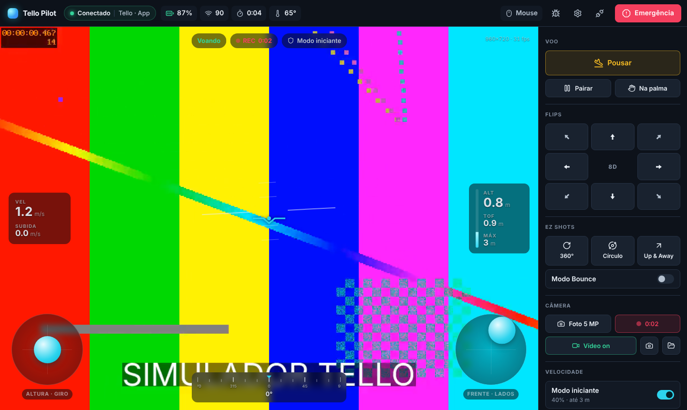
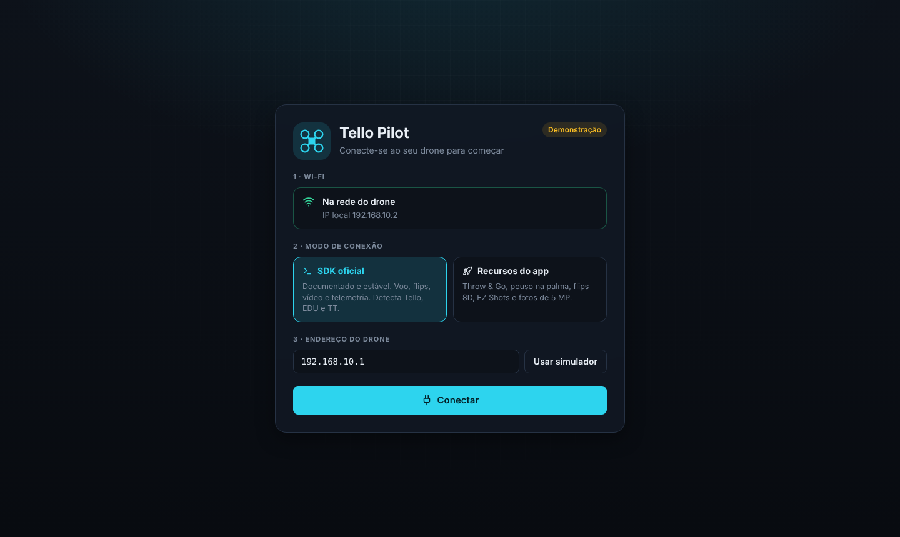
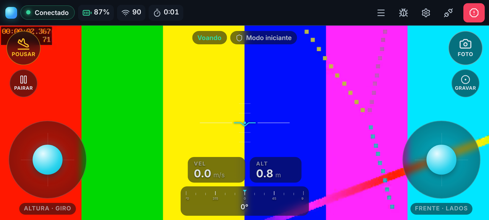

# Tello Pilot

Cliente para o drone **DJI/Ryze Tello** no **Windows, macOS, Linux, Android e iOS**, com os protocolos implementados do zero, sem bibliotecas de Tello.



- Vídeo ao vivo (H.264 decodificado pela placa de vídeo via WebCodecs)
- HUD com horizonte artificial, altitude, velocidade, rumo, bateria e sinal
- Controle por **toque** e **mouse** (sticks virtuais), **teclado** e **controle Xbox** (com vibração)
- No celular: layout próprio em paisagem, com botões grandes de decolar/pousar, foto e gravação
- Dois modos de conexão:
  - **SDK oficial**: documentado e estável. Detecta Tello, Tello EDU e RoboMaster TT.
  - **Recursos do app**: Throw & Go, pouso na palma, flips 8D, EZ Shots (360°, círculo, Up & Away), modo Bounce, modo rápido e fotos de 5 MP.
- Gravação de vídeo em MP4 e capturas da tela
- Segurança: decolagem segurando o botão, modo iniciante, altura máxima, pouso automático com bateria baixa, emergência sempre visível
- Caixa-preta: log de todos os pacotes, exportável para diagnóstico

## Download

Baixe a versão mais recente na página de **[Releases](../../releases/latest)**:

| Plataforma | Arquivo |
|---|---|
| Windows 10/11 | `Tello-Pilot_x.y.z_windows_x64-setup.exe` |
| macOS 11+ (Intel e Apple Silicon) | `Tello-Pilot_x.y.z_macos_universal.dmg` |
| Linux | `Tello-Pilot_x.y.z_linux_amd64.AppImage` ou `.deb` |
| Android 7+ | `Tello-Pilot_x.y.z_android_universal.apk` |
| iOS 16.4+ | `Tello-Pilot_x.y.z_ios_unsigned.ipa` |

O `tello-cli` (diagnóstico pelo terminal) também vem anexado para Windows, macOS e Linux, e o `SHA256SUMS.txt` traz os checksums de todos os arquivos.

### Instalação

Nenhum instalador tem assinatura paga, então cada sistema pede uma confirmação na primeira vez.

- **Windows:** o SmartScreen pode avisar. Clique em **Mais informações → Executar assim mesmo**. O instalador pede permissão de administrador para criar a regra do Firewall: sem ela, o Windows bloqueia a telemetria e o vídeo, porque classifica a rede do Tello como "Pública".
- **macOS:** arraste o app para **Aplicativos**. Na primeira abertura, clique com o botão direito no app → **Abrir**. No macOS 15 ou mais novo, vá em **Ajustes do Sistema → Privacidade e Segurança → Abrir Mesmo Assim**.
- **Linux:** o AppImage roda direto (`chmod +x Tello-Pilot_*.AppImage`). O `.deb` instala com `sudo apt install ./Tello-Pilot_*.deb`. Veja as [limitações](#limitações-conhecidas) sobre o vídeo.
- **Android:** abra o APK e permita instalar de "fontes desconhecidas". No Android 17 ou mais novo, permita **Dispositivos por perto** quando o app pedir: é a permissão de rede local, sem a qual o sistema bloqueia a conversa com o drone. Ao entrar no Wi-Fi do drone, se o Android avisar que a rede não tem internet, escolha **manter a conexão**.
- **iOS** (sem App Store): instale o `.ipa` com o [Sideloadly](https://sideloadly.io) (Windows/macOS) ou o [AltStore](https://altstore.io), usando o seu Apple ID. Depois, no iPhone:
  1. ative **Ajustes → Privacidade e Segurança → Modo de Desenvolvedor**;
  2. confie no seu Apple ID em **Ajustes → Geral → VPN e Gerenciamento de Dispositivos**;
  3. na primeira conexão, permita o acesso à **rede local**.

  Com um Apple ID gratuito, o app precisa ser reinstalado a cada **7 dias** (o AltStore renova sozinho).

## Primeiro teste: diagnóstico sem decolar

Antes de voar, rode o `tello-cli.exe` com o drone ligado e o computador no Wi-Fi `TELLO-XXXXXX`:

```
tello-cli.exe
```

Ele **não decola**. O programa:

1. confere se o computador está na rede do drone;
2. conecta e mostra modelo, versão do SDK, serial e bateria;
3. mostra a telemetria por 10 s;
4. grava 10 s de vídeo em `tello-video-AAAAMMDD-HHMMSS.mp4`;
5. salva o log `tello-log-AAAAMMDD-HHMMSS.jsonl`.

No final aparece um resumo `[ok]` / `[falha]` para cada item. Se algo falhar, o arquivo de log mostra exatamente o que foi enviado e recebido.

Opções: `--ip`, `--segundos`, `--saida <pasta>`. O modo `tello-cli.exe shell` abre um console para digitar comandos do SDK (`battery?`, `takeoff`, `land`…).

## Usando o app



1. Ligue o drone e conecte o computador ou o celular ao Wi-Fi dele.
2. Escolha o modo (**SDK oficial** ou **Recursos do app**) e clique em **Conectar**.
3. O vídeo liga sozinho. Para decolar, **segure** o botão "Segure para decolar" por 1 segundo.

No celular, a tela fica em paisagem e os sticks ficam nos cantos de baixo. Decolar/pousar e pairar ficam à esquerda; foto e gravação, à direita. O botão ☰ abre os demais comandos (flips, EZ Shots, modos).



### Controles

| Ação | Mouse / toque | Teclado | Controle Xbox |
|---|---|---|---|
| Subir/descer · girar | Stick esquerdo | W/S · A/D | Stick esquerdo |
| Frente/trás · lados | Stick direito | Setas | Stick direito |
| Decolar | Segurar o botão | Segurar T | Segurar Menu |
| Pousar | Botão Pousar | L | Menu (no ar) |
| Pairar | Botão Pairar | Espaço | B |
| Foto | Botão Foto | P | A |
| Gravar vídeo | Botão Gravar | R | X |
| Flips | Painel 8D | — | LB + D-pad (duas direções = diagonal) |
| Throw & Go / pouso na palma | Botões | — | RB |
| Modo rápido (modo App) | Chave | — | Y |
| **Emergência** (corta os motores) | Botão vermelho | Esc duas vezes | View + Menu |

O mapeamento segue o **modo 2** (o do app oficial). Nas configurações dá para trocar para o modo 1, ajustar zona morta e expo, e inverter o eixo frente/trás.

### Segurança

- **Modo iniciante** (ligado por padrão): sticks limitados a 40% e altura máxima de 3 m.
- **Pouso automático** quando a bateria chega a 10% (configurável), com alertas em 20% e 15% e vibração no controle.
- Se o controle desconectar, a janela perder o foco, o app for para o segundo plano ou parar de mandar comandos, os sticks voltam ao centro e o drone **paira**.
- A tela não apaga nem bloqueia enquanto o drone está conectado.
- Fechar o app com o drone voando abre uma confirmação para pousar antes.
- Flips ficam desativados abaixo de 50% de bateria, porque o próprio drone recusa.

### Estabilidade

Quem segura o drone no ar é o controlador de voo dele, com a IMU, a câmera de baixo e o sensor de distância. O app ajuda do lado de cá: avisa quando o ambiente atrapalha e cuida do link.

- **Avisos de condição de voo.** Cada aviso aparece como um selo no topo da tela enquanto a condição dura (e só depois de ela se manter por 3 s):
  - **Pouca luz** (modo App): a câmera de baixo precisa de luz e de um chão com textura; sem isso o drone deriva.
  - **Vento forte** (modo App), detectado pelo próprio drone.
  - **Sinal Wi-Fi fraco**, abaixo de 30%. No modo SDK o app consulta o sinal a cada 5 s.
  - **Acima de 6 m**: a câmera de baixo deixa de enxergar o chão.
- **Qualidade de vídeo adaptativa** (modo App, ligada por padrão). O app mede os pacotes de vídeo perdidos. Se a perda passa de 5% por 2 s, ele baixa a taxa do drone um nível, até 1 Mbps; depois de 15 s sem perda, sobe de novo até o teto escolhido em **Configurações → Vídeo**. A cada perda o app também pede um quadro-chave na hora, para a imagem se recompor rápido. Os níveis do drone são 1, 1,5, 2, 3 e 4 Mbps. No modo SDK, só o Tello EDU e o RoboMaster TT (SDK 3) aceitam taxa fixa.
- **Reconexão automática.** Se a telemetria some por 5 s, o app refaz a conexão do zero (sockets novos e handshake) a cada 2 s, e o topo da tela mostra "Reconectando… (tentativa N)". Ao voltar, religa o vídeo e o modo rápido como estavam. Sem comandos por uns 15 s, o Tello pousa sozinho; por isso a reconexão começa cedo. Enquanto ela acontece, os comandos são recusados com o aviso "reconectando".
- **Relatório do voo.** Da decolagem ao pouso, o app guarda uma amostra por segundo de bateria, altura, Wi-Fi, temperatura e perda de vídeo, além dos avisos e de quando cada condição esteve ativa. No pouso, salva um `voo-<data>-<hora>.html` na pasta de logs, com o resumo, gráficos, uma linha do tempo e as **possíveis causas** de instabilidade (pouca luz, vento, sinal fraco, vídeo perdendo pacotes, temperatura, bateria, quedas de conexão). No computador, o aviso de fim de voo tem o botão **Abrir relatório**; no celular, abra o arquivo pela pasta de logs (tabela abaixo). O arquivo não depende de internet: abre em qualquer navegador.
- **Calibração da IMU** (modo App), em **Configurações → Calibração da IMU**. Use quando o drone deriva mesmo com boa luz e sem vento, ou depois de uma queda. Com as hélices fora e o drone no chão, toque em **Calibrar** e gire o drone pelas 6 posições (normal, de cabeça para baixo, de cada lado e com o nariz para cima e para baixo), segurando cada uma até o contador avançar. No fim, desligue e ligue o drone. Com o drone voando, o comando é recusado.
- **Calibração do centro de massa** (modo App, **experimental**), em **Configurações → Centro de massa**. Serve para o drone que puxa sempre para o mesmo lado ao pairar, mesmo com a IMU calibrada. O comando (`0x1054` com valor 1) só aparece na documentação da comunidade, sem teste conhecido; por isso o app só o envia com o drone pairando a menos de 1,5 m, com os sticks soltos e sem vento detectado, pede confirmação e grava na caixa-preta tudo o que o drone responder. Use num lugar fechado, com espaço, e com o dedo no botão de emergência.

Os itens marcados com "modo App" dependem do protocolo do app oficial: conecte em **Recursos do app**. No modo **SDK oficial** o drone não informa luz, vento nem perda de vídeo, e não aceita as calibrações.

### IA (experimental)

Em **Configurações → IA**, o app reconhece pessoas no vídeo com o detector de pose do [MediaPipe](https://ai.google.dev/edge/mediapipe/solutions/vision/pose_landmarker), que marca 33 pontos do corpo. Vem desligada.

- **Tudo no aparelho.** O motor e o modelo vêm dentro do app, e a análise roda num worker, sem travar a interface. Nada precisa de internet (no Wi-Fi do drone ela nem existe). O MediaPipe tenta enviar métricas de uso ao Google; o app bloqueia esse envio e qualquer outro acesso à rede a partir da IA.
- **Desempenho.** Até 15 análises por segundo, numa cópia do quadro reduzida a 480×360. O app tenta a GPU e passa para a CPU se ela falhar ou for lenta (sem placa de vídeo, a GPU é emulada e fica umas dez vezes mais lenta). O status aparece nas configurações, por exemplo "Pronta · CPU · 11 análises/s · 54 ms".
- **Limites do modelo.** Funciona melhor com uma pessoa por vez, a até uns 4 m, com boa luz e a cabeça visível. Por causa do atraso do vídeo (200 a 300 ms), só serve para movimentos lentos.
- **Tamanho.** O motor e o modelo somam uns 19 MB no app (9 MB comprimidos). O APK universal do Android leva uma cópia do app para cada tipo de processador, então lá eles pesam três vezes.

### Onde ficam os arquivos

| Tipo | Windows, macOS e Linux | Android | iOS |
|---|---|---|---|
| Fotos de 5 MP e capturas | `Imagens/Tello Pilot` | Galeria, pasta `Pictures/Tello Pilot` | App **Arquivos** → Tello Pilot → `Fotos` |
| Vídeos gravados (MP4) | `Vídeos/Tello Pilot` | Galeria, pasta `Movies/Tello Pilot` | App **Arquivos** → Tello Pilot → `Videos` |
| Logs exportados e relatórios de voo | `Documentos/Tello Pilot/logs` | `Documents/Tello Pilot` | App **Arquivos** → Tello Pilot → `Logs` |

No Android 10 ou mais antigo, tudo fica na pasta do app (`Android/data/io.github.kaikoaugustin.tellopilot/files/Documents`).

## Problemas comuns

| Sintoma | Causa provável |
|---|---|
| "O drone não respondeu" | O computador/celular não está no Wi-Fi do drone, o drone está desligado ou o app oficial está aberto no celular. |
| Não conecta no iPhone | Em **Ajustes → Tello Pilot**, ligue **Rede Local**. |
| Não conecta no Android | No Android 17+, permita **Dispositivos por perto** em **Ajustes → Apps → Tello Pilot → Permissões**. Confirme também que o Android manteve o Wi-Fi do drone mesmo "sem internet"; desligar os dados móveis ajuda. |
| Conecta, mas sem telemetria/vídeo | Firewall do Windows bloqueando a rede pública. Reinstale como administrador ou libere o Tello Pilot em **Segurança do Windows → Firewall → Permitir um aplicativo** (marque *Redes públicas*). |
| Recurso aparece desativado | Ele não existe no modo ou modelo atual. Passe o mouse sobre o botão para ver o motivo. |
| Modo App não conecta | Desligue e ligue o drone: depois de usar o SDK ele pode continuar nesse modo até reiniciar. |

Em qualquer problema, abra a **caixa-preta** (ícone de inseto) e use **Exportar log**.

## Limitações conhecidas

- **Linux:** o vídeo depende do WebKitGTK ter H.264 no WebCodecs, o que varia com a distro. Instale `gstreamer1.0-libav` e `gstreamer1.0-plugins-bad`; se ainda assim não houver vídeo, o resto do app (telemetria, sticks, comandos) funciona normalmente.
- **Android:** o WebView não expõe a Gamepad API, então o controle Xbox ainda não funciona no Android (use os sticks na tela). No iOS o controle funciona.
- **iOS:** sem conta Apple Developer não há App Store nem TestFlight, e o app instalado com Apple ID gratuito expira em 7 dias.
- **macOS:** o app não é notarizado pela Apple (veja a [instalação](#instalação)).

## Versões e releases

Todo commit no `main` gera uma release automaticamente (`.github/workflows/release.yml`):

1. a versão é calculada pelos commits desde a última tag `vX.Y.Z`;
2. se o `main` permitir, um commit `chore(release): vX.Y.Z` atualiza a versão nos arquivos e o `CHANGELOG.md`;
3. os instaladores das 5 plataformas são gerados (`.github/workflows/build.yml`, que também roda em todo PR);
4. a tag e a release são publicadas com o changelog e os arquivos.

Como a versão sobe:

| Mensagem do commit | Exemplo | Salto |
|---|---|---|
| `feat: ...` ou `[minor]` em qualquer lugar | `Suporte a iOS [minor]` | 0.1.0 → 0.2.0 |
| `tipo!: ...`, `BREAKING CHANGE` no corpo ou `[major]` | `feat!: novo protocolo` | 0.1.0 → 1.0.0 |
| qualquer outra | `Corrige o vídeo` | 0.1.0 → 0.1.1 |

Também dá para escolher o salto em **Actions → Release → Run workflow**, ou subir a versão à mão com `node scripts/release/version.mjs set X.Y.Z` (ela é respeitada se for maior que a última tag).

### Configuração (uma vez)

**Chave do Android (obrigatória para atualizar o app instalado).** O Android só aceita uma atualização assinada com a mesma chave. Gere a chave uma vez e guarde o arquivo `.jks` e as senhas em lugar seguro: sem eles, quem já tem o app precisa desinstalar para instalar uma versão nova.

```powershell
# O keytool vem com o Java (JDK) ou com o Android Studio (pasta jbr\bin).
keytool -genkeypair -v -keystore tello-pilot.jks -alias tello-pilot -keyalg RSA -keysize 2048 -validity 10000

# Converte para base64 e copia para a área de transferência (PowerShell):
[Convert]::ToBase64String([IO.File]::ReadAllBytes("tello-pilot.jks")) | Set-Clipboard
# No Linux: base64 -w0 tello-pilot.jks · no macOS: base64 -i tello-pilot.jks
```

Em **Settings → Secrets and variables → Actions → New repository secret**, cadastre:

| Secret | Valor |
|---|---|
| `ANDROID_KEYSTORE_BASE64` | o base64 do `.jks` |
| `ANDROID_KEYSTORE_PASSWORD` | a senha do keystore |
| `ANDROID_KEY_ALIAS` | `tello-pilot` (o `-alias` usado acima) |
| `ANDROID_KEY_PASSWORD` | a senha da chave (se for a mesma do keystore, repita) |

Sem esses secrets o APK sai assinado com uma chave temporária (o build avisa), que não atualiza o app já instalado.

**Commit automático de versão (opcional).** O `main` tem uma ruleset que recusa push direto, inclusive do Actions. Sem configurar nada, as releases saem normalmente, mas os arquivos do repositório e o `CHANGELOG.md` ficam na versão anterior (a versão é aplicada só no build). Para o commit de versão entrar no `main`:

1. crie um token *fine-grained* (**Settings → Developer settings → Personal access tokens**) com acesso a este repositório e permissão **Contents: Read and write**;
2. cadastre-o como secret `RELEASE_TOKEN`;
3. na ruleset do `main` (**Settings → Rules → Rulesets**), adicione **Repository admin** em *Bypass list*.

## Desenvolvimento

Requisitos: Rust (stable), Node.js 22. No Linux, também as dependências do Tauri (`libwebkit2gtk-4.1-dev` e afins). Para Android: Android Studio (SDK e NDK) e Java 17+. Para iOS: macOS com Xcode e `xcodegen`.

```bash
npm install

cargo test -p tello-core -p tello-sim -p tello-cli   # testes (unitários + integração com o simulador)
npm run check                                         # checagem de tipos da interface
npm run test:scripts                                  # testes do script de versão

npm run dev          # só a interface, no navegador, com um backend simulado
npx tauri dev        # app completo
cargo run -p tello-sim                                # simulador de Tello em 127.0.0.1
cargo run -p tello-cli -- --ip 127.0.0.1              # diagnóstico contra o simulador

npx tauri android init && npx tauri android dev        # Android (aparelho ou emulador)
npx tauri ios init && npx tauri ios dev                # iOS (só no macOS)
```

No navegador, `npm run dev` e abrir `http://localhost:5173/?mobile=1` (ou `?mobile=ios`) simula o app no celular. Os projetos nativos gerados em `src-tauri/gen` não vão para o repositório: o código nativo fica no plugin `crates/tauri-plugin-tello-mobile`.

Com o simulador rodando, use **Usar simulador** na tela de conexão (IP `127.0.0.1`). Ele funciona nos dois modos (SDK e App) e envia vídeo de teste, telemetria e fotos.

### Estrutura

```
crates/tello-core   protocolos (SDK e App), vídeo, gravação MP4, segurança, caixa-preta
crates/tello-sim    simulador do drone + testes de integração
crates/tello-cli    diagnóstico e console de comandos
crates/tauri-plugin-tello-mobile
                    ajustes nativos do celular (Kotlin e Swift): Wi-Fi sem internet, tela acesa, paisagem
src-tauri           app: ponte entre o núcleo e a interface, configuração por plataforma
ui                  interface (Svelte 5 + TypeScript)
scripts/release     versão automática e changelog
```

### Dependências

O que é o coração do projeto é feito à mão: os protocolos do Tello, CRCs, montagem do vídeo, parser de SPS e o gravador MP4. O que é infraestrutura grande vem pronto: decodificação de vídeo (WebCodecs, do próprio sistema), controle (Gamepad API), janela e instalador (Tauri), interface (Svelte), serialização (serde) e detecção de pose para a IA (MediaPipe).

### Protocolos

- **SDK oficial**: comandos de texto em UDP para `192.168.10.1:8889`. Estado a ~10 Hz na porta local 8890, vídeo H.264 na 11111. `rc` a 20 Hz mantém o drone no ar (ele pousa sozinho após 15 s sem comandos).
- **Protocolo do app**: pacotes binários `0xCC` com CRC-8/CRC-16, handshake `conn_req:`, sticks a 50 Hz, telemetria de voo (0x56), atitude pela IMU (0x1051) e transferência de fotos (0x62/0x63/0x64). O formato vem de documentação pública da comunidade. Os CRCs já foram validados com um pacote real publicado; os demais detalhes serão confirmados com os logs dos primeiros voos (caixa-preta).

## Próximos passos

- Controle Xbox no Android (ponte nativa para os eventos do controle)
- Publicação na App Store / TestFlight e na Play Store (exige as contas de desenvolvedor)

## Licença

GPL-3.0. Ícones do [Lucide](https://lucide.dev) (licença ISC). Motor e modelo de pose do [MediaPipe](https://github.com/google-ai-edge/mediapipe) (licença Apache-2.0, ver `ui/src/ai/LICENSE-mediapipe.txt`).
